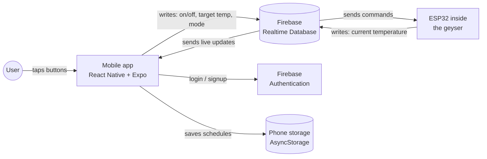
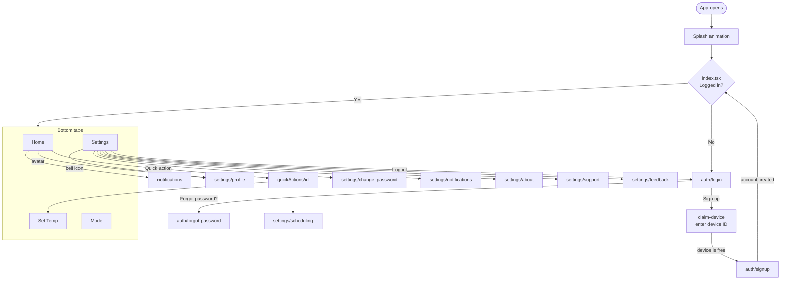
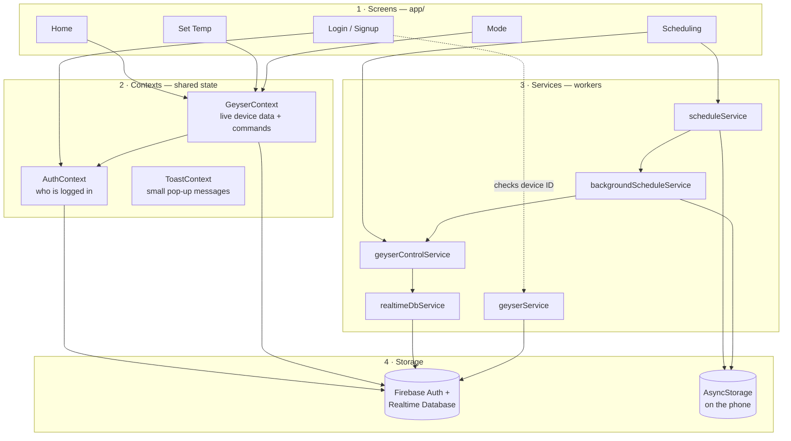
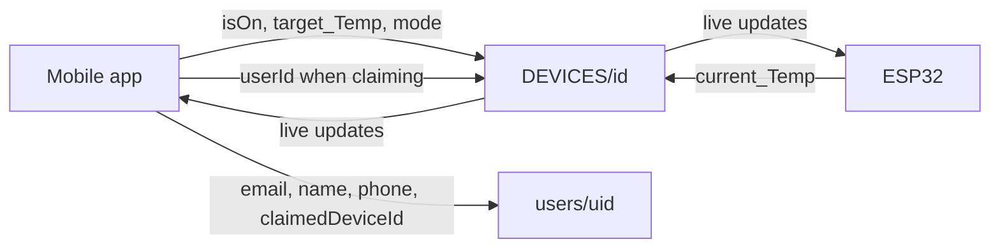
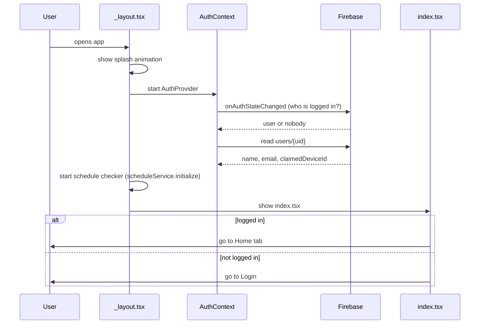
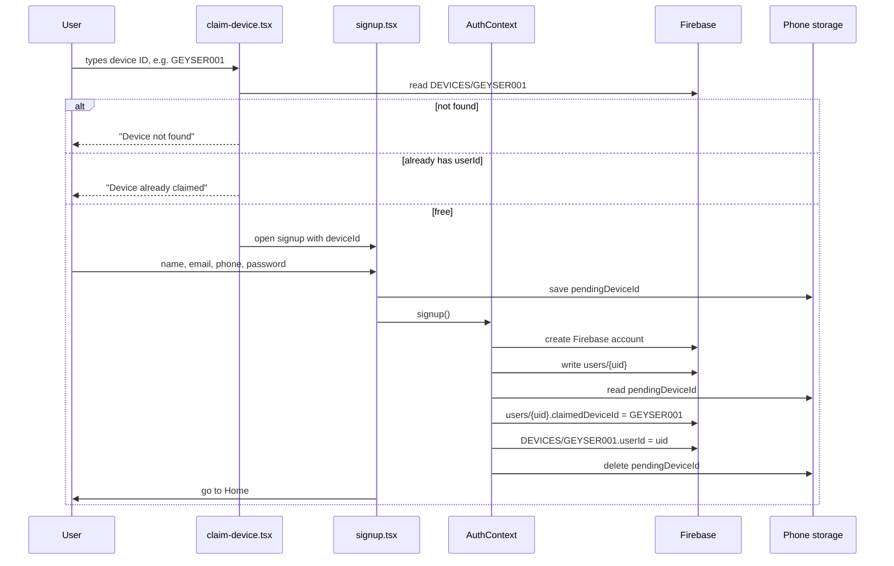
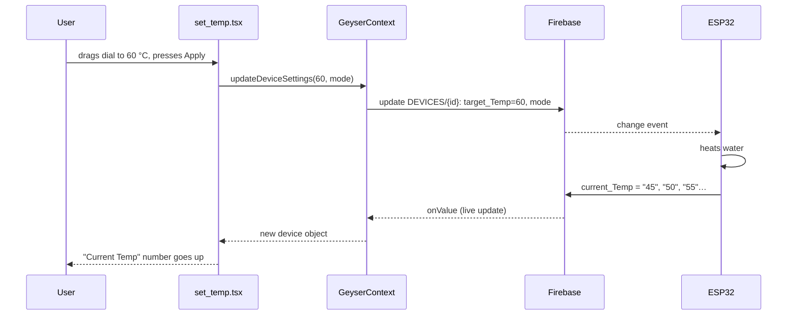

# Understanding the Smart IoT Geyser App

This document explains the whole project in simple English: what the app does, how it is built, which file does what, how data moves, and what is still broken or missing.

If you only want to run the app, read [README.md](README.md) first.

---

## Table of contents

1. [What is this app?](#1-what-is-this-app)
2. [The big picture](#2-the-big-picture)
3. [Technologies used](#3-technologies-used)
4. [Folder structure](#4-folder-structure)
5. [Screens and navigation](#5-screens-and-navigation)
6. [Features: what works and what is only a demo](#6-features-what-works-and-what-is-only-a-demo)
7. [Architecture: how the code is organised](#7-architecture-how-the-code-is-organised)
8. [The database (Firebase)](#8-the-database-firebase)
9. [Data flow: step by step](#9-data-flow-step-by-step)
10. [File-by-file guide](#10-file-by-file-guide)
11. [Limitations](#11-limitations)
12. [Bugs to fix](#12-bugs-to-fix)
13. [Suggested next steps](#13-suggested-next-steps)
14. [Glossary](#14-glossary)

---

## 1. What is this app?

**Smart IoT Geyser** is a mobile app for controlling a water heater (a "geyser") from your phone.

The geyser has a small computer inside called an **ESP32**. The ESP32 and the app never talk to each other directly. Both of them read from and write to the same online database, **Firebase Realtime Database**. The database works like a shared notice board between them.

With the app, a user can:

- create an account and link ("claim") their geyser to it,
- see the current water temperature,
- turn the geyser on or off,
- set a target temperature (30–100 °C),
- choose a heating mode: **Electric**, **Gas** or **Hybrid**,
- create daily schedules, for example "turn on at 7:00 AM for 30 minutes at 50 °C".

Each account can control **one** geyser, and each geyser belongs to **one** account.

---

## 2. The big picture



In plain words:

1. **The user taps a button** in the app, for example "Geyser ON".
2. **The app writes** `isOn: true` into the geyser's entry in Firebase.
3. **The ESP32 is watching** that same entry. It sees the change and switches the heater on.
4. **The ESP32 writes** the new water temperature (`current_Temp`) back to Firebase.
5. **The app is also watching**, so the new temperature appears on screen almost straight away.

Schedules work differently. They are saved **only on the phone**, not in Firebase, and the app itself turns the geyser on and off at the right times. More on this in [Limitations](#11-limitations).

---

## 3. Technologies used

| Technology | What it is used for |
| --- | --- |
| **React Native 0.79** | Builds the mobile app in JavaScript/TypeScript. |
| **Expo SDK 53** | Tools around React Native: running, building, icons, fonts, splash screen. |
| **Expo Router 5** | Navigation. Every file inside `app/` automatically becomes a screen. |
| **TypeScript** | JavaScript with types, which catches mistakes earlier. |
| **Firebase Authentication** | Email and password login. |
| **Firebase Realtime Database** | Stores users and devices, and sends live updates. |
| **AsyncStorage** | A small key-value store on the phone. Holds schedules and usage numbers. |
| **expo-background-fetch / expo-task-manager** | Tries to check schedules while the app is in the background. |
| **react-native-circular-progress, react-native-svg** | Round temperature dials. |
| **@expo/vector-icons (MaterialCommunityIcons)** | All icons in the app. |
| **expo-linear-gradient** | Gradient buttons. |

Some packages are **installed but never used** in the code: `@react-native-firebase/*`, `expo-camera`, `expo-notifications`, `react-native-video`, `expo-av`, `lucide-react-native`, and NativeWind/Tailwind class names. They make the app bigger, and they can be removed later.

---

## 4. Folder structure

```text
NIESmart-GeyserAppDevelopment-main/
│
├── app/                      ← SCREENS (each file = one screen, thanks to Expo Router)
│   ├── _layout.tsx           ← Root of the app: wraps everything in providers, shows splash
│   ├── index.tsx             ← First screen: decides "go to login" or "go to home"
│   ├── globals.css           ← Tailwind/NativeWind base styles
│   │
│   ├── (tabs)/               ← The 4 bottom tabs (the "(tabs)" name does not appear in URLs)
│   │   ├── _layout.tsx       ← The floating bottom tab bar
│   │   ├── index.tsx         ← Home / dashboard
│   │   ├── set_temp.tsx      ← Temperature control
│   │   ├── mode.tsx          ← Electric / Gas / Hybrid
│   │   └── settings.tsx      ← Settings menu + logout
│   │
│   ├── auth/
│   │   ├── login.tsx         ← Login
│   │   ├── signup.tsx        ← Create account (needs a device ID first)
│   │   └── forgot-password.tsx ← Send a password-reset email
│   │
│   ├── claim-device.tsx      ← Step 1 of signing up: enter and check a device ID
│   ├── add-geyser.tsx        ← "Add a geyser" with Master/Slave roles (demo only)
│   ├── geyser-management.tsx ← List of geysers (uses MOCK data – crashes, see bugs)
│   ├── manual-entry.tsx      ← Type a QR code by hand (demo only)
│   ├── notifications.tsx     ← Notification list (fake, hard-coded messages)
│   ├── quickActions/[id].tsx ← Redirects Home "quick action" buttons to real screens
│   │
│   └── settings/
│       ├── scheduling.tsx    ← REAL schedule manager (create / toggle / delete)
│       ├── scheduling/create.tsx ← Old schedule form (does not save anything)
│       ├── profile.tsx       ← Shows name/email/phone (editing does not save)
│       ├── change_password.tsx ← Form only (does not change the password)
│       ├── notifications.tsx ← Notification preferences (UI only)
│       ├── energy.tsx        ← Energy charts (sample numbers)
│       ├── maintenance.tsx   ← Maintenance checklist (sample data)
│       ├── feedback.tsx      ← Feedback form (does not send)
│       ├── support.tsx       ← FAQ + contact links (placeholder email/phone)
│       └── about.tsx         ← App version and info
│
├── components/               ← REUSABLE UI PIECES (buttons, cards, dials, alerts)
├── contexts/                 ← SHARED APP STATE (logged-in user, device data, toasts)
├── services/                 ← LOGIC THAT TALKS TO FIREBASE / STORAGE / SCHEDULER
├── config/firebase.ts        ← Firebase connection settings
├── constants/                ← Colours, spacing, icon names, image paths
├── utils/alertUtils.ts       ← Alert helpers (not used anywhere yet)
├── interfaces/, types/       ← TypeScript types (interfaces.d.ts is leftover movie-app code)
├── scripts/                  ← One-off Node scripts to set up or clean the Firebase database
├── assets/                   ← Images, icons, fonts
├── android/                  ← Native Android project (only needed for native builds)
│
├── app.json                  ← Expo app settings (name, icon, permissions, owner)
├── eas.json                  ← Settings for building APKs with Expo's cloud (EAS)
├── package.json              ← List of libraries + npm scripts
├── babel.config.js, metro.config.js, tailwind.config.js, tsconfig.json ← Build tool settings
└── *.md                      ← Older notes written during development
```

**How to remember it:** `app/` = what you **see**, `components/` = **building blocks**, `contexts/` = **shared memory**, `services/` = **workers** that do jobs.

---

## 5. Screens and navigation

### 5.1 Navigation map



Some screens exist but **no menu leads to them**: `geyser-management`, `add-geyser`, `manual-entry`, `settings/energy`, `settings/maintenance` and `settings/scheduling/create`. You can only reach them by typing their route in code.

### 5.2 What each tab shows

| Tab | What you see | What you can do |
| --- | --- | --- |
| **Home** | Current temperature in a coloured circle, an on/off switch, today's usage time, number of active schedules, and a background picture that changes with temperature (cold / warm / hot) | Turn the geyser on or off. Jump to Temperature, Mode, Settings or Scheduling. |
| **Set Temp** | Current and target temperature, a big dial, presets | Pick 30–100 °C (snaps to steps of 10), then press **Apply Temperature**. |
| **Mode** | Three cards: Electric, Hybrid, Gas, with efficiency and cost | Choose a mode, then press **Apply**. |
| **Settings** | Account and support menu | Open sub-pages or **Logout**. |

---

## 6. Features: what works and what is only a demo

✅ = works with real data · ⚠️ = works, but with problems · 🎭 = looks real, but is only a demo (nothing is saved or sent)

| Feature | Status | Notes |
| --- | --- | --- |
| Login with email and password | ✅ | Firebase Auth. Error messages are generic (see bugs). |
| Sign up (with device claim) | ✅ | You must enter a valid, unclaimed device ID first. |
| Forgot password email | ✅ | Firebase sends a reset email. |
| Logout | ✅ | |
| Stay logged in after closing the app | ⚠️ | Probably not. Login is kept only in memory (see bugs). |
| See live temperature | ✅ | Comes from the ESP32 through Firebase. |
| Turn geyser on/off | ✅ | Writes `isOn`. |
| Set target temperature | ✅ | Writes `target_Temp`. |
| Change mode | ✅ | Writes `mode`. |
| Create / enable / disable / delete schedules | ⚠️ | Saved on the phone only. Runs reliably only while the app is open. |
| "Today's usage" time | ⚠️ | An estimate made by the app, and it over-counts (see bugs). |
| "Last updated" time on Home | 🎭 | A random time. It is not real. |
| Notifications list | 🎭 | Hard-coded example messages. |
| Profile edit | 🎭 | Says "updated" but saves nothing. |
| Change password | 🎭 | Says "changed" but changes nothing. |
| Feedback form | 🎭 | Says "sent" but sends nothing. |
| Energy and Maintenance pages | 🎭 | Sample numbers. |
| Support page | 🎭 | Placeholder email and phone numbers. |
| QR code scanning | 🎭 | Shows "Coming soon". |
| Add geyser with Master/Slave roles | 🎭 | Only shows success messages. |
| Manage several geysers | 🎭 | Uses fake (mock) data and crashes if opened. |
| Push notifications | ❌ | Not built. |

---

## 7. Architecture: how the code is organised

The app has **four layers**. Each layer only talks to the layer below it.



### 7.1 Providers (the "wrapping" order)

In [app/_layout.tsx](app/_layout.tsx) the whole app is wrapped like this:

```text
<AuthProvider>            ← knows the user
  <GeyserProvider>        ← needs the user, to know which device to watch
    <ToastProvider>       ← small pop-up messages
      <RootLayoutNav />   ← splash, loading spinner, then all screens
```

The order matters: `GeyserProvider` uses `useAuth()`, so it must sit **inside** `AuthProvider`.

### 7.2 What a "context" means here

A **context** is shared memory that any screen can read. Instead of every screen loading the user and the device on its own:

- `useAuth()` gives `{ user, loading, login, signup, logout, resetPassword }`
- `useGeyser()` gives `{ device, loading, updateDeviceSettings, updateGeyserOnOff, updateDeviceMode, claimDevice, unclaimDevice, … }`

When Firebase sends new data, the context updates and **every screen using it redraws automatically**.

### 7.3 Services

Services are plain TypeScript classes. Each file creates **one shared instance** of its class, for example `export const scheduleService = new ScheduleService()`.

| Service | Job |
| --- | --- |
| `scheduleService` | Front door for scheduling: save and load schedules, start the checker, track usage time. |
| `backgroundScheduleService` | The real "clock-watcher": every minute it checks whether a schedule should start or stop. |
| `geyserControlService` | Turns the geyser on or off. It uses `GeyserContext` when available, and otherwise writes to Firebase directly (for background use). |
| `realtimeDbService` | Small helpers to read and write `DEVICES/{id}` in Firebase. |
| `geyserService` | Helpers used by the claim and add-geyser screens to check whether a device or user exists. |
| `firebaseService.ts` | **Empty file.** |

---

## 8. The database (Firebase)

### 8.1 Structure

Firebase Realtime Database is one big JSON tree. This app uses two main branches:

```text
(root)
├── users/
│   └── {firebaseUserId}/
│       ├── email:           "ali@example.com"
│       ├── displayName:     "Ali"
│       ├── phone:           "03001234567"
│       └── claimedDeviceId: "GEYSER001"      ← which geyser this user owns
│
└── DEVICES/
    └── {deviceId}/                           e.g. "GEYSER001"
        ├── current_Temp: "42"                ← written by ESP32 (a STRING)
        ├── target_Temp:  50                  ← written by app (a NUMBER)
        ├── mode:         "electric"          ← "electric" | "gas" | "hybrid" (any capitalisation)
        ├── isOn:         true                ← written by app
        └── userId:       "{firebaseUserId}"  ← who owns this geyser
```

The link goes **both ways**: `users/{uid}/claimedDeviceId` points to the device, and `DEVICES/{id}/userId` points back to the user.

Some older code also writes to `localDevices/` and `logs/` (in `geyserService.ts`), but the current screens do not use it.

### 8.2 Who writes what



### 8.3 Security rules

[FIREBASE_RULES_UPDATE.md](FIREBASE_RULES_UPDATE.md) suggests these rules:

- `users/{uid}`: only that user can read or write.
- `DEVICES/{id}`: **any logged-in user** can read **and write**.

This document cannot confirm which rules are actually live in the Firebase console. If these are the live rules, any logged-in user could change any geyser (see [bugs](#12-bugs-to-fix)).

---

## 9. Data flow: step by step

### 9.1 Opening the app



### 9.2 Signing up and claiming a geyser

New users **must** have a geyser. The flow is: **claim the device first, then create the account.**



The "pending device" claim is tried in **three places** as safety nets: in `signup()`, in `onAuthStateChanged` inside `AuthContext`, and in `app/index.tsx`. Whichever runs first does the claim, and the others see it is already done.

### 9.3 Changing the temperature



Turning on/off (`updateGeyserOnOff`) and changing mode (`updateDeviceMode`) work the same way. Only the field that gets written is different.

### 9.4 Live updates from the ESP32

`GeyserContext` keeps **one live listener** (`onValue`) on `DEVICES/{claimedDeviceId}`. Every time anything changes there, whether from the ESP32, this phone or another phone:

1. Firebase sends the whole device object to the app.
2. `mode` is normalised to lowercase (`"Gas"` → `"gas"`).
3. `device` state is updated.
4. Home, Set Temp and Mode redraw with the new values.

### 9.5 Schedules

```mermaid
flowchart TD
    A[User creates schedule<br/>settings/scheduling.tsx] --> B[scheduleService.saveSchedules]
    B --> C[(AsyncStorage<br/>@geyser_schedules)]

    T1[Timer every 60 s<br/>backgroundScheduleService] --> CHK
    T2[Timer every 120 s<br/>scheduleService legacy] --> CHK
    T3[Background fetch<br/>when OS allows] --> CHK

    CHK{checkAndExecuteSchedules<br/>Is current time exactly<br/>a schedule's start or end?}
    C --> CHK
    CHK -->|start time matches| ON[geyserControlService.turnOnGeyser temp]
    CHK -->|end time matches| OFF[geyserControlService.turnOffGeyser]
    ON --> W[(Firebase DEVICES/id<br/>isOn=true, target_Temp)]
    OFF --> W2[(Firebase DEVICES/id<br/>isOn=false)]
    ON --> ACT[(AsyncStorage<br/>@active_schedule)]
```

How a schedule is stored, for example:

```json
{ "id": 1731400000000, "name": "Schedule 1", "time": "07:00 AM",
  "endTime": "07:30 AM", "temperature": 50, "duration": 30,
  "enabled": true, "icon": "weather-sunny" }
```

- The checker builds the current time as text (for example `"07:00 AM"`) and compares it with `time` and `endTime`. It must be **exactly equal**, to the minute.
- Schedules repeat **every day**. There is no day-of-week choice.
- `duration` is in **minutes**.

### 9.6 Keys saved on the phone (AsyncStorage)

| Key | What it holds |
| --- | --- |
| `@geyser_schedules` | List of all schedules |
| `@active_schedule` | The schedule that is currently running (so it knows when to stop) |
| `@device_id` | Claimed device ID, so the scheduler can work without the screens |
| `@geyser_usage_tracking` | Today's estimated "geyser on" time |
| `@schedule_execution_log` | Last 100 schedule start/stop events |
| `@last_schedule_check` | When the scheduler last ran |
| `pendingDeviceId`, `pendingDeviceName` | Temporary: a device waiting to be claimed during signup |

---

## 10. File-by-file guide

### 10.1 Root and screens (`app/`)

| File | What it does |
| --- | --- |
| [app/_layout.tsx](app/_layout.tsx) | Entry point. Wraps the app in `AuthProvider → GeyserProvider → ToastProvider`. Shows the splash, then a loading spinner, then the screen stack. Starts the schedule system once. |
| [app/index.tsx](app/index.tsx) | "Traffic police": sends you to `/(tabs)` if logged in, or `/auth/login` if not. Also finishes any pending device claim. |
| [app/(tabs)/_layout.tsx](app/(tabs)/_layout.tsx) | Draws the floating rounded bottom tab bar with 4 tabs. |
| [app/(tabs)/index.tsx](app/(tabs)/index.tsx) | Home dashboard: temperature ring, on/off switch, usage time, active schedule count, quick actions. |
| [app/(tabs)/set_temp.tsx](app/(tabs)/set_temp.tsx) | Temperature dial. Snaps to 30, 40 … 100. **Apply** calls `updateDeviceSettings`. |
| [app/(tabs)/mode.tsx](app/(tabs)/mode.tsx) | Electric / Hybrid / Gas picker. **Apply** calls `updateDeviceMode`. |
| [app/(tabs)/settings.tsx](app/(tabs)/settings.tsx) | Settings menu. Opens `/settings/{key}`. Logout asks for confirmation, then calls `logout()`. |
| [app/auth/login.tsx](app/auth/login.tsx) | Email/password form with basic checks (empty, email format, length ≥ 6). "Sign up" goes to `claim-device`. |
| [app/auth/signup.tsx](app/auth/signup.tsx) | Name, email, phone, password, confirm. Receives `deviceId` from claim-device. Saves it as pending, then calls `signup()`. |
| [app/auth/forgot-password.tsx](app/auth/forgot-password.tsx) | Sends a Firebase reset email, then shows a "check your inbox" screen. |
| [app/claim-device.tsx](app/claim-device.tsx) | Checks a device ID in Firebase: not found, already claimed, or free (then go to signup). QR button is "Coming soon". |
| [app/add-geyser.tsx](app/add-geyser.tsx) | Checks a geyser ID, then asks Master or Slave. **Only shows messages, saves nothing.** |
| [app/geyser-management.tsx](app/geyser-management.tsx) | Multi-geyser list. **Uses `MockGeyserContext` and crashes** (see bugs). |
| [app/manual-entry.tsx](app/manual-entry.tsx) | Type a QR code or device ID by hand. Does not pass the value anywhere. |
| [app/notifications.tsx](app/notifications.tsx) | List of notifications. **Hard-coded examples.** Mark-read and clear work only in memory. |
| [app/quickActions/[id].tsx](app/quickActions/[id].tsx) | Turns a quick-action id like `set_temperature` into a real route like `/set_temp`. |
| [app/settings/scheduling.tsx](app/settings/scheduling.tsx) | **The real schedule screen.** 2-step pop-up: pick time, then temperature and duration. Toggle, delete and "check now". Shows the active schedule. |
| [app/settings/scheduling/create.tsx](app/settings/scheduling/create.tsx) | Older schedule form. **Does not save.** |
| [app/settings/profile.tsx](app/settings/profile.tsx) | Shows the user's name, email and phone. Edit and save does **not** write to Firebase. |
| [app/settings/change_password.tsx](app/settings/change_password.tsx) | Password form with a strength meter. Does **not** change the password. |
| [app/settings/notifications.tsx](app/settings/notifications.tsx) | Notification toggles (UI only). |
| [app/settings/energy.tsx](app/settings/energy.tsx) | Energy usage page with sample data. |
| [app/settings/maintenance.tsx](app/settings/maintenance.tsx) | Maintenance tasks with sample data. |
| [app/settings/feedback.tsx](app/settings/feedback.tsx) | Star rating and text. Does **not** send. |
| [app/settings/support.tsx](app/settings/support.tsx) | FAQ plus email/phone buttons (placeholder contacts). |
| [app/settings/about.tsx](app/settings/about.tsx) | App version, team info, links. |

### 10.2 Contexts (`contexts/`)

| File | What it does |
| --- | --- |
| [contexts/AuthContext.tsx](contexts/AuthContext.tsx) | Listens to Firebase login state. Loads and keeps `users/{uid}` live. Gives `login`, `signup`, `logout`, `resetPassword`. Handles the pending device claim. |
| [contexts/GeyserContext.tsx](contexts/GeyserContext.tsx) | Watches `DEVICES/{claimedDeviceId}` live. Gives `device` plus commands: `updateDeviceSettings`, `updateGeyserOnOff`, `updateDeviceMode`, `claimDevice`, `unclaimDevice`. Also stores `@device_id` for the scheduler. |
| [contexts/ToastContext.tsx](contexts/ToastContext.tsx) | `showToast(message, type)` for small pop-ups. Set up, but no screen uses it yet. |
| [contexts/MockAuthContext.tsx](contexts/MockAuthContext.tsx) | Fake login for testing without Firebase. **Not wired in.** |
| [contexts/MockGeyserContext.tsx](contexts/MockGeyserContext.tsx) | Fake multi-geyser data. **Only used by `geyser-management.tsx`, which makes it crash.** |

### 10.3 Services (`services/`)

| File | Main functions |
| --- | --- |
| [services/scheduleService.ts](services/scheduleService.ts) | `initialize()`, `saveSchedules()`, `getSchedules()`, `forceCheckSchedules()`, `getCurrentActiveSchedule()`, `clearActiveSchedule()`, `getUsageTracking()`, `updateUsageTracking()` |
| [services/backgroundScheduleService.ts](services/backgroundScheduleService.ts) | `initialize()` registers the background task and a 60-second timer. `checkAndExecuteSchedules()` is the core start/stop logic. Also `getExecutionLog()` and `cancelAllSchedules()`. |
| [services/geyserControlService.ts](services/geyserControlService.ts) | `turnOnGeyser(temp)`, `turnOffGeyser()`, `setContext()`, `setDeviceId()`, `getDeviceStatus()` |
| [services/realtimeDbService.ts](services/realtimeDbService.ts) | `getDevice`, `updateDevice`, `setDevice`, `onDeviceChange`, `setTemperature`, `setMode`, `setPowerState` |
| [services/geyserService.ts](services/geyserService.ts) | `getDeviceData`, `getUserData`, `claimDevice`, `unclaimDevice`, `initializeDevice`, `getUserDevices` and more (only the first two are used by screens). |
| [services/firebaseService.ts](services/firebaseService.ts) | Empty. |

### 10.4 Components (`components/`)

| File | What it draws | Used? |
| --- | --- | --- |
| `DarkCard.tsx` | Dark rounded card container | ✅ everywhere |
| `GradientButton.tsx` | Big gradient button | ✅ |
| `MetricCard.tsx` | Small "title + value" stat card | ✅ |
| `CircularProgress.tsx` | Coloured ring with centre content (Home) | ✅ |
| `CustomAlert.tsx` | Styled pop-up dialog. Helpers: `showError`, `showSuccess`, `showInfo`, `showConfirm` | ✅ |
| `ProfileAvatar.tsx` | Circle with the user's initials | ✅ |
| `SplashScreen.tsx` | Animated start screen | ✅ |
| `AppHeader.tsx` | Simple back-button header | ✅ (profile, manual-entry) |
| `Toast.tsx` | Slide-in message bar | ✅ via ToastContext |
| `BackgroundScheduleTest.tsx` | Debug panel for the scheduler | ❌ not used |
| `BarChart.tsx`, `ThermostatDial.tsx`, `TransactionItem.tsx` | Extra UI pieces | ❌ not used |

### 10.5 Other folders

| Path | What it is |
| --- | --- |
| [config/firebase.ts](config/firebase.ts) | Firebase keys and set-up. Exports `auth`, `database` (Realtime DB), `db` (Firestore, unused) and `functions` (unused). |
| [constants/theme.ts](constants/theme.ts) | Colours, spacing, corner radius, shadows and gradients for the dark theme. |
| [constants/iconMappings.ts](constants/iconMappings.ts) | `getIconName()` maps short names to MaterialCommunityIcons names. |
| `constants/icons.ts`, `constants/images.ts` | Image `require()` lists. |
| `utils/alertUtils.ts` | Alert helpers. **Not used.** |
| `interfaces/interfaces.d.ts` | Types for **movies**, left over from a tutorial project. Not related to this app. |
| `scripts/*.js` | Run with `node scripts/<file>.js` to add test devices, check the DB, migrate old data or clean up test data. **They change the live database.** |

---

## 11. Limitations

These are design limits: things the app cannot do because of how it is built.

1. **Schedules live only on one phone.** They are stored in AsyncStorage, not Firebase. If you log in on another phone, reinstall, or clear app data, the schedules are gone. Two family members cannot share schedules.
2. **Schedules mostly need the app to be open.** Android and iOS only let background tasks run about every 15 minutes or more, and sometimes never. Because the checker needs the time to match **to the exact minute**, background runs almost always miss it. Background tasks are also limited inside Expo Go.
3. **The phone is the "brain" for schedules.** If the phone is off, has no internet, or the app is killed, the geyser will not turn on or off on schedule. A safer design is for the ESP32, or a Firebase Cloud Function, to run schedules.
4. **One geyser per account, one account per geyser.** No family sharing, and no multiple geysers. The Master/Slave and multi-geyser screens are only mock-ups.
5. **No real "online/offline" status.** The app cannot tell whether the ESP32 is connected. The "Online/Offline" label on Home actually shows **on/off**.
6. **Usage and energy numbers are guesses.** They are not measured by the device.
7. **No push notifications.** There are no alerts for "water is ready" or "temperature too high" when the app is closed.
8. **No QR scanning.** Device IDs must be typed.
9. **Old Expo SDK (53).** The Play Store version of Expo Go no longer runs it, so you must install the SDK 53 Expo Go by hand. Newer SDKs require React Native's "New Architecture", which this app has turned off (`"newArchEnabled": false`).
10. **Firebase keys are in the source code** ([config/firebase.ts](config/firebase.ts) and every script). Firebase web keys are not secret by design, but then the **security rules are the only protection**, so they must be strict.

---

## 12. Bugs to fix

Sorted from most to least important. Each one says **what**, **where**, **why it matters** and **how to fix it**.

### 🔴 High priority

**B1. "Geyser Management" screen crashes**
- **Where:** [app/geyser-management.tsx:10](app/geyser-management.tsx#L10)
- **What:** It imports `useGeyser` from `MockGeyserContext`, but there is no `MockGeyserProvider` in the app, so the hook throws an error as soon as the screen opens.
- **Fix:** Use the real `GeyserContext`, or remove the screen until multi-geyser support exists.

**B2. Users may be logged out every time the app restarts**
- **Where:** [config/firebase.ts:27](config/firebase.ts#L27)
- **What:** `getAuth(app)` on React Native keeps the login only in memory.
- **Fix:** Use `initializeAuth(app, { persistence: getReactNativePersistence(AsyncStorage) })`.

**B3. After unclaiming a device, schedules can still control it**
- **Where:** [contexts/GeyserContext.tsx:313-331](contexts/GeyserContext.tsx#L313-L331)
- **What:** `unclaimDevice()` clears Firebase, but not `@device_id` in AsyncStorage or `geyserControlService`. The scheduler keeps using the old device ID, which may now belong to someone else.
- **Fix:** Remove `@device_id`, clear the service's device ID, and clear schedules on unclaim and on logout.

**B4. Scheduled "turn on" overwrites the real temperature**
- **Where:** [services/geyserControlService.ts:110](services/geyserControlService.ts#L110)
- **What:** In background mode it writes `current_Temp = target temperature`. The app then shows fake data, for example "50 °C" when the water is cold, until the ESP32 writes again.
- **Fix:** Delete that line. Only the ESP32 should write `current_Temp`.

**B5. Security: any logged-in user can control any geyser**
- **Where:** Firebase rules (suggested in [FIREBASE_RULES_UPDATE.md](FIREBASE_RULES_UPDATE.md))
- **What:** `DEVICES/$id` allows `.write` for `auth != null`.
- **Fix:** Allow writes only when `data.child('userId').val() === auth.uid`, or when the device has no owner and the write sets `userId` to `auth.uid`. Give the ESP32 its own account or rule.

**B6. Device check before signup may fail because of the rules**
- **Where:** [app/claim-device.tsx:44](app/claim-device.tsx#L44) and [app/claim-device.tsx:53](app/claim-device.tsx#L53)
- **What:**
  - The user is **not logged in yet**, but the suggested rules need `auth != null` to read `DEVICES`.
  - The screen also reads **another user's** `users/{uid}`, which the rules block. That shows "Check failed" instead of "Device already claimed".
- **Fix:** Only check `deviceData.userId` exists, without reading the other user. Allow reading only the `userId` field without login, or check the device after the account is created.

### 🟠 Medium priority

**B7. Schedules can run twice, or be skipped**
- **Where:**
  - two timers: [services/backgroundScheduleService.ts:83](services/backgroundScheduleService.ts#L83) (60 s) and [services/scheduleService.ts:151](services/scheduleService.ts#L151) (120 s)
  - exact-match check: [backgroundScheduleService.ts:120](services/backgroundScheduleService.ts#L120) and [:135](services/backgroundScheduleService.ts#L135)
  - extra setup call: [app/settings/scheduling.tsx](app/settings/scheduling.tsx) calls `initializeBackgroundTask()` again each time you open the screen
- **What:**
  - Two separate timers, plus two background tasks, all call the same check. The "turn on" can be sent more than once in the same minute.
  - Each visit to the Scheduling screen adds **another** 2-minute timer that never stops.
  - Timers drift, so a whole minute can be skipped and the schedule silently missed.
- **Fix:**
  - Keep **one** checker.
  - Compare with a time window, for example "start time is between last check and now".
  - Remember "already ran today" per schedule.

**B8. `cancelAllSchedules()` calls a function that does not exist**
- **Where:** [services/scheduleService.ts:100](services/scheduleService.ts#L100)
- **What:** It calls `backgroundScheduleService.cancelAllNotifications()`, but the real name is `cancelAllSchedules()`. It fails every time (the error is caught and logged).
- **Fix:** Rename the call.

**B9. 12 AM schedules get the wrong end time**
- **Where:** [app/settings/scheduling.tsx:171](app/settings/scheduling.tsx#L171)
- **What:** For 12 AM, `setHours(12)` sets **noon**. So a 12:00 AM schedule for 30 minutes gets an end time of 12:30 **PM** and runs for 12½ hours.
- **Fix:** Convert 12 AM to hour 0: `hour24 = period === 'AM' ? (h % 12) : (h % 12) + 12`.

**B10. "Today's usage" time over-counts**
- **Where:** [app/(tabs)/index.tsx:157-183](app/(tabs)/index.tsx#L157-L183)
- **What:** The effect adds 5 minutes **every time it runs**, and it re-runs on **every** Firebase update (each new temperature reading). Ten readings means 50 "minutes" added.
- **Fix:** Track the time `isOn` became true and add the real elapsed time when it turns off. Better still, let the ESP32 or Firebase record it.

**B11. Temperature dial jumps back while you are adjusting it**
- **Where:** [app/(tabs)/set_temp.tsx:55](app/(tabs)/set_temp.tsx#L55)
- **What:** The dial resets to `target_Temp` whenever **any** device field changes, including each new `current_Temp` from the ESP32. Your unsaved choice is lost.
- **Fix:** Run the effect only when `device?.target_Temp` changes: `[device?.target_Temp]`.

**B12. Login always says "Login failed"**
- **Where:** [app/auth/login.tsx:69](app/auth/login.tsx#L69)
- **What:** `AuthContext.login()` builds helpful messages ("Incorrect password", "No account found"…), but the screen throws them away.
- **Fix:** Show `error.message`. Do the same in signup.

**B13. Old geyser context gets stuck inside `geyserControlService`**
- **Where:** [app/settings/scheduling.tsx:21](app/settings/scheduling.tsx#L21) and [services/geyserControlService.ts](services/geyserControlService.ts)
- **What:** The Scheduling screen saves the whole context object into the service and never clears it. Later, the scheduler uses an **old copy** (old user, old device), even after logout.
- **Fix:** Do not store the context. Always use the direct Firebase path with the current `@device_id`.

**B14. Claiming is not atomic**
- **Where:** [contexts/GeyserContext.tsx:268-294](contexts/GeyserContext.tsx#L268-L294) and [contexts/AuthContext.tsx:106-125](contexts/AuthContext.tsx#L106-L125)
- **What:** The code reads "is it free?", then writes. Two people claiming at the same moment could both succeed.
- **Fix:** Use Firebase `runTransaction()` on `DEVICES/{id}/userId`, or a multi-path `update()` checked by security rules.

### 🟡 Low priority / clean-up

| # | Problem | Where | Fix |
| --- | --- | --- | --- |
| B15 | "Last Updated" shows a **random** time | [app/(tabs)/index.tsx:129](app/(tabs)/index.tsx#L129) | Have the ESP32 write a `lastUpdated` timestamp and show that. |
| B16 | "Online/Offline" really means On/Off | [app/(tabs)/index.tsx:264-268](app/(tabs)/index.tsx#L264-L268) | Rename it to "On/Off", or add a real heartbeat from the ESP32. |
| B17 | `NaN °C` if `current_Temp` is missing | [app/(tabs)/index.tsx:82](app/(tabs)/index.tsx#L82), [set_temp.tsx](app/(tabs)/set_temp.tsx) | `parseInt(x) \|\| 0`, or show "--". |
| B18 | Profile, password, feedback and old schedule-create screens say "Success" but do nothing | [profile.tsx:44](app/settings/profile.tsx#L44), [change_password.tsx:38](app/settings/change_password.tsx#L38), [feedback.tsx:25](app/settings/feedback.tsx#L25), [scheduling/create.tsx:33](app/settings/scheduling/create.tsx#L33) | Connect them to Firebase (`update(users/uid)`, `updatePassword` + re-authentication), or label them "coming soon". |
| B19 | `updateDeviceName()` always throws an error | [contexts/GeyserContext.tsx:239-247](contexts/GeyserContext.tsx#L239-L247) | Implement it or remove it. |
| B20 | `unclaimDevice` in two services writes `undefined`, which Firebase rejects | [geyserService.ts:222](services/geyserService.ts#L222), [realtimeDbService.ts:131](services/realtimeDbService.ts#L131) | Use `null` (these functions are currently unused). |
| B21 | Listener variable is re-created every render, so `logout()` cannot clean it up | [contexts/AuthContext.tsx:49](contexts/AuthContext.tsx#L49) | Store it in `useRef`. |
| B22 | `GeyserContext` re-subscribes to Firebase on every mode change, and both branches of an `if` do the same thing | [contexts/GeyserContext.tsx:160-168](contexts/GeyserContext.tsx#L160-L168), [:192](contexts/GeyserContext.tsx#L192) | Remove `lastUserModeChange` from the dependencies and delete the duplicate branch. |
| B23 | Quick action route `/current_temp` does not exist | [app/quickActions/[id].tsx:13](app/quickActions/[id].tsx#L13) | Remove it or point it to `/set_temp`. |
| B24 | `normalizeMode()` is copy-pasted in 4 files | Home, Set Temp, Mode, GeyserContext, geyserControlService | Move it to one shared `utils/mode.ts`. |
| B25 | Target temperature up to **100 °C** | [set_temp.tsx](app/(tabs)/set_temp.tsx), [scheduling.tsx](app/settings/scheduling.tsx) | Most home geysers are limited to about 60–75 °C for safety. Cap it in the app **and** on the ESP32. |
| B26 | Dead files and packages | `firebaseService.ts` (empty), `interfaces.d.ts` (movie types), `utils/alertUtils.ts`, unused components, unused npm packages, empty `SEPARATE_SCHEDULES_IMPLEMENTATION.md` | Delete them to keep the project clean and the app smaller. |
| B27 | A lot of `console.log` on every render and update | Contexts and screens | Remove them, or wrap them in `if (__DEV__)`. |

---

## 13. Suggested next steps

If you are taking over this project, this order gives the most value for the effort:

1. **Fix the crashes and wrong data:** B1, B4, B9, B10, B11, B12.
2. **Lock down security:** B5, B6, B14. Write proper Firebase rules and test them.
3. **Keep users logged in:** B2.
4. **Move schedules into Firebase:** save them under `schedules/{uid}` or `DEVICES/{id}/schedules`, and let the **ESP32** (or a Cloud Function) turn the heater on and off. This fixes limitations 1–3 and bugs B3, B7, B8 and B13 in one go.
5. **Add device heartbeat:** the ESP32 writes `lastSeen` every minute, so the app can show real Online/Offline and "Last updated".
6. **Finish the demo screens** (profile edit, change password, notifications), or hide them.
7. **Clean up:** B24, B26, B27.
8. **Upgrade Expo SDK** step by step (53 → 54 → … → latest) once the app is stable.

---

## 14. Glossary

| Word | Meaning |
| --- | --- |
| **Geyser** | A water heater. |
| **ESP32** | A small, cheap Wi-Fi computer chip placed inside the geyser to control it. |
| **IoT** | "Internet of Things": everyday devices connected to the internet. |
| **Firebase** | Google's online service for login, databases and more. |
| **Realtime Database** | A Firebase database that **pushes** changes to every listener instantly. |
| **Claim a device** | Link a geyser's ID to your account, so only you control it. |
| **Context (React)** | Shared data that any screen can read without passing it manually. |
| **Provider** | The component that holds a context's data and wraps the screens that need it. |
| **Hook** | A React function starting with `use…`, for example `useAuth()`, that gives a screen access to data or features. |
| **Service** | A plain class that does one job, for example talking to Firebase or checking schedules. |
| **AsyncStorage** | Simple storage on the phone, like a small notebook kept inside the app. |
| **Expo Go** | A ready-made app from Expo that can run your project without building your own APK. |
| **Expo Router** | Makes every file in `app/` a screen automatically. `(tabs)` is a group folder that does not show in the URL. |
| **SDK version** | The Expo release the project is built on (here 53). Expo Go must match it. |
| **onValue** | A Firebase function: "call me every time this data changes". |
| **Mock** | Fake data or code used for testing or demos. |
