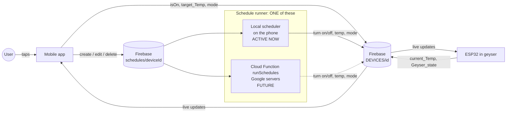
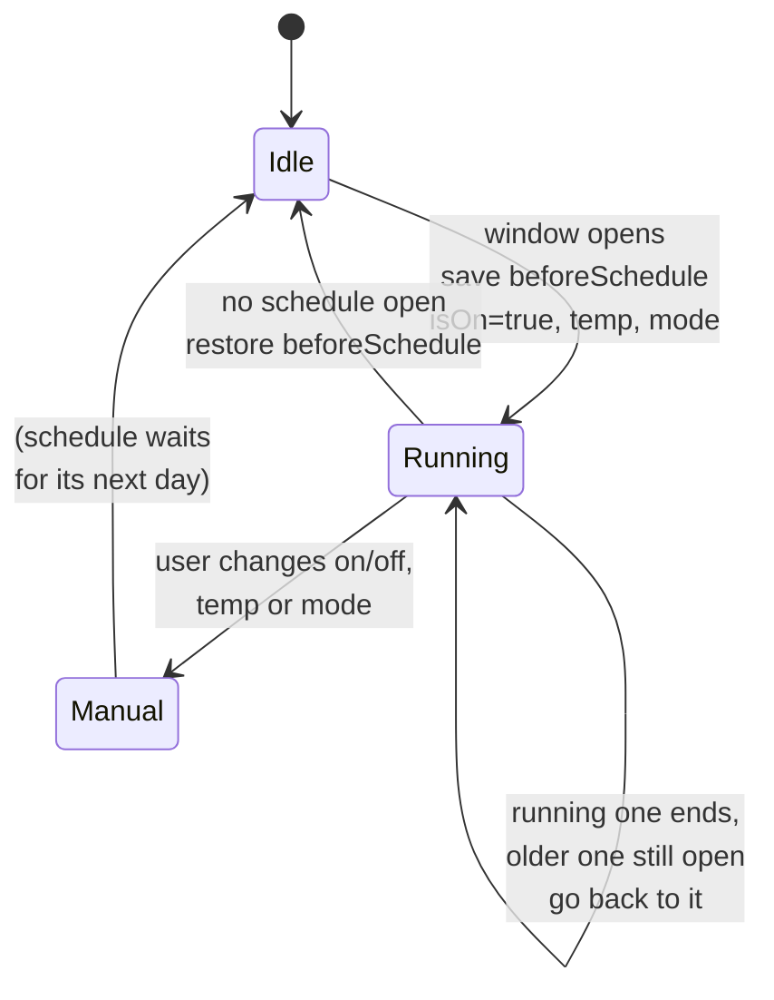
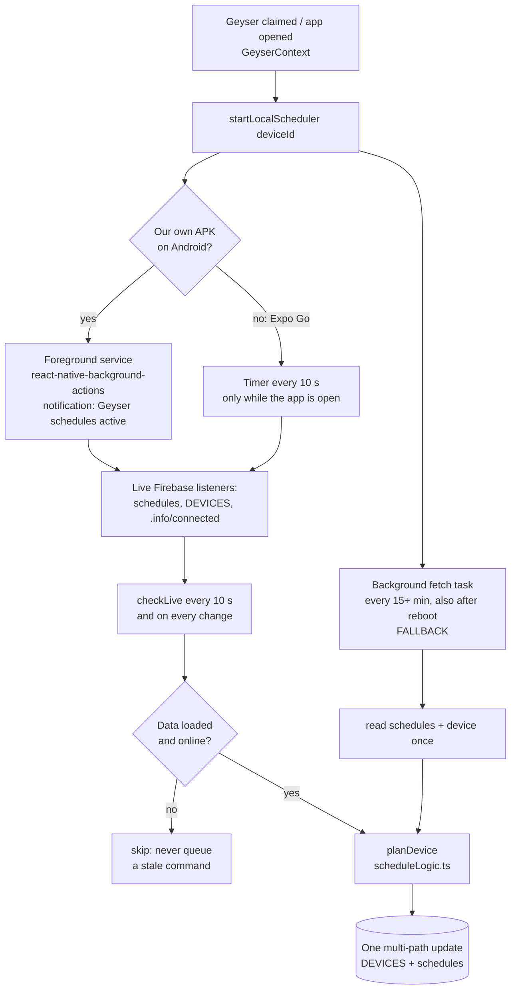
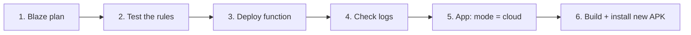

# Updated Understanding: what changed since the original project

[Understanding.md](Understanding.md) describes the project **as it was received** (commit `4b16790`), including its bugs.
This document describes **everything that has changed since then**, how scheduling works now, and how to move scheduling to the cloud later.

Read both: Understanding.md for the parts that did not change (login, claiming, screens), this file for what is new.

---

## Table of contents

1. [Summary](#1-summary)
2. [How the app works now](#2-how-the-app-works-now)
3. [Scheduling: the two schedulers](#3-scheduling-the-two-schedulers)
4. [The schedule rules](#4-the-schedule-rules)
5. [Database changes](#5-database-changes)
6. [Local scheduler (current)](#6-local-scheduler-current)
7. [Cloud Function (ready, not deployed)](#7-cloud-function-ready-not-deployed)
8. [How to switch to the Cloud Function](#8-how-to-switch-to-the-cloud-function)
9. [Other app changes](#9-other-app-changes)
10. [Original bugs: fixed and still open](#10-original-bugs-fixed-and-still-open)
11. [Every file that changed](#11-every-file-that-changed)
12. [Building and running](#12-building-and-running)
13. [Known issues and next steps](#13-known-issues-and-next-steps)

---

## 1. Summary

| Area | Before | Now |
| --- | --- | --- |
| Where schedules are saved | Only on one phone (AsyncStorage) | **Firebase** `schedules/{deviceId}`, shared by every phone, with an offline copy on the phone |
| Who runs schedules | Several timers on the phone, needing an exact-minute match | **One** scheduler using one set of tested rules: the **local scheduler** on the phone today, a **Cloud Function** later |
| Schedule fields | Start time + duration, every day | **Start time + end time**, chosen **days of the week**, temperature, **mode** |
| Schedule screen | Old list + separate create screen | New one-page list + bottom sheet editor with a custom clock picker |
| Overlapping schedules | Not handled | Newest wins; when it ends, the geyser **goes back** to the earlier one that is still open |
| After a schedule | Geyser turned off | Geyser goes back to **the settings it had before** (saved in `beforeSchedule`) |
| Manual change during a schedule | Could be overridden | Stops that schedule **for today only** |
| Home status | "Online/Offline" label (really on/off) | **Wi-Fi icon** (phone's internet) + **mode icons** while the hardware reports `Geyser_state = true` |
| Offline phone | Commands queued and sent later | Commands **blocked** with a "No internet connection" popup |
| Logout | Schedule data stayed on the phone | Local data cleared, warning if anything is not synced yet |
| Installable app | Only Expo Go | **APK** built with EAS (cloud build, free) |

---

## 2. How the app works now



The ESP32 does **not** need to know about schedules. A schedule simply changes `isOn`, `target_Temp` and `mode` in `DEVICES/{id}`, exactly as if the user had tapped the buttons, and the ESP32 reacts as it always did.

---

## 3. Scheduling: the two schedulers

Both schedulers use **the same rules file**: [functions/src/scheduleLogic.ts](functions/src/scheduleLogic.ts). Only "who runs it, and how often" differs.

| | Local scheduler (current) | Cloud Function (future) |
| --- | --- | --- |
| Runs on | The user's phone | Google's servers |
| How often | Every **10 seconds** | Every **1 minute** |
| Phone off / no internet | ❌ Nothing runs | ✅ Still works |
| App closed (our APK) | ✅ Every 10 s (background service + notification) | ✅ Not affected |
| App closed (Expo Go) | ⚠️ About every 15+ min (Android decides) | ✅ Not affected |
| Cost | Free | Needs the Firebase **Blaze** plan (a card is required; normal use stays inside the free quota) |
| Main file | [services/localScheduler.ts](services/localScheduler.ts) | [functions/src/index.ts](functions/src/index.ts) |

**The switch:** [constants/scheduler.ts](constants/scheduler.ts)

```ts
export const SCHEDULER_MODE: 'local' | 'cloud' = 'local';
```

> ⚠️ **Never run both at once.** When you move to the cloud, deploy the function **and** release an app with `'cloud'` together. See [section 8](#8-how-to-switch-to-the-cloud-function).

**Why the local scheduler?** The Cloud Function could not be deployed because the Blaze plan was refused (a virtual card was rejected). The local scheduler was added **for testing**, and it is now the main scheduler. The Cloud Function code is kept so the project can go back to it.

---

## 4. The schedule rules

These are in [scheduleLogic.ts](functions/src/scheduleLogic.ts) (function `planDevice`) and covered by **35 automatic tests** ([scheduleLogic.test.ts](functions/src/scheduleLogic.test.ts)).

1. **Time window.** A schedule is "open" from its start time up to (not including) its end time, on its chosen days, in the `Asia/Karachi` timezone. If the end is earlier than the start (e.g. 23:00 → 01:00) it runs past midnight and belongs to the day it started.
2. **Once per day.** Each schedule starts at most once per occurrence (`lastStartDate`). So if you switch it off by hand halfway, it does **not** switch itself back on.
3. **Start.** When an open schedule has not started yet, the geyser is turned on with its temperature and mode. If several start together, the most recent start wins.
4. **Overlap, go back.** When the running schedule ends (or is disabled or deleted) while another one is still open, the geyser **returns to that other schedule**.
   Example: A 7:00–8:00 at 50 °C, B 7:15–7:45 at 60 °C → 7:00 A, 7:15 B, 7:45 back to A, 8:00 end.
5. **Remember and restore.** Before the first schedule takes control, the geyser's own settings (`isOn`, `target_Temp`, `mode`) are saved in `DEVICES/{id}/beforeSchedule`. When no schedule is open any more, they are **restored**.
6. **Manual change wins.** On/off, temperature or mode changed by hand clears `activeScheduleId` and `beforeSchedule`. The schedule stops controlling the geyser **for today**, and runs again on its next day.

Because the rules ask "is the window open **right now**?" instead of "is it exactly 7:00?", a late check still does the right thing, just late. This fixes the old "missed minute" bug.



---

## 5. Database changes

### 5.1 New branch: `schedules/`

```text
schedules/
└── {deviceId}/                      e.g. "GEYSER001"
    └── {scheduleId}/                 Firebase push id
        ├── name:          "Schedule 1"
        ├── startTime:     "07:00"            ← 24-hour, local time
        ├── endTime:       "07:30"            ← earlier than startTime = ends next day
        ├── temperature:   50                 ← 30–100
        ├── mode:          "electric"         ← "electric" | "gas" | "hybrid"
        ├── days:          [1, 2, 3, 4, 5]    ← 0 = Sunday … 6 = Saturday
        ├── enabled:       true
        ├── timezone:      "Asia/Karachi"
        ├── lastStartDate: "2026-11-24"       ← written by the scheduler
        ├── createdAt:     1764000000000      ← milliseconds since 1970 (a timestamp)
        └── updatedAt:     1764000000000
```

Schedules are stored **per device**, so every phone logged into that geyser's account sees the same list. Old schedules that only have `durationMinutes` are still understood.

### 5.2 New fields in `DEVICES/{deviceId}`

| Field | Written by | Meaning |
| --- | --- | --- |
| `activeScheduleId` | Scheduler; the app clears it on manual changes | Which schedule is controlling the geyser right now (`null` = none) |
| `beforeSchedule` | Scheduler; the app clears it on manual changes | `{ isOn, target_Temp, mode }` saved before the first schedule took control, restored afterwards |
| `Geyser_state` | **ESP32 (hardware team)** | `true` while the geyser is **really heating**. The Home screen shows the mode icons only while this is `true`. |

> **For the hardware team:** write `DEVICES/{deviceId}/Geyser_state` as a **boolean**, when the heating state changes and once after boot. It is different from `isOn` (the user's command).

### 5.3 Security rules

The database rules are **deliberately left open for now**, until it is known how the ESP32 signs in to Firebase. `firebase.json` has **no `database` section** on purpose, so a deploy can never change the rules by accident. The live rules are backed up in [docs/firebase/database.rules.live-backup.json](docs/firebase/database.rules.live-backup.json).

### 5.4 Keys saved on the phone (AsyncStorage)

| Key | What it holds |
| --- | --- |
| `@schedules_cache:{deviceId}` | Copy of the schedule list, so it shows while offline |
| `@schedules_outbox:{deviceId}` | Schedule changes made offline, sent when the connection is back |
| `@local_scheduler_device` | Device the local scheduler runs for (needed by the background task) |
| `@local_scheduler_last_run` | When the local scheduler last checked |
| `@geyser_usage_tracking` | Today's estimated usage (unchanged, now in `usageService`) |

The old keys (`@geyser_schedules`, `@active_schedule`, `@device_id`, `@schedule_execution_log`, `@last_schedule_check`) are migrated once and then removed. All schedule keys are cleared on logout.

---

## 6. Local scheduler (current)

File: [services/localScheduler.ts](services/localScheduler.ts)



- **Starts** in [contexts/GeyserContext.tsx](contexts/GeyserContext.tsx) when a device is claimed.
- **Stops** on unclaim and on logout ([contexts/AuthContext.tsx](contexts/AuthContext.tsx)).
- **On open**, [app/_layout.tsx](app/_layout.tsx) calls `cleanUpBackgroundTasks()` to remove the old app's background tasks.
- **Reading data:** it uses **live listeners**, so the 10-second checks don't download anything new. The data is already on the phone.
- **Offline:** when the phone is offline it does nothing, so no command gets queued and sent at the wrong time.
- **Android 14+ background service:**
  - Needs a declared type. We use `specialUse`, declared by the config plugin [plugins/withBackgroundActions.js](plugins/withBackgroundActions.js).
  - We don't use `dataSync`, because Android 15 limits it to 6 hours a day.
  - Android 13+ asks the user for notification permission.

**Phone settings for reliable background runs (Samsung):** Settings → Apps → Smart IoT Geyser → Battery → **Unrestricted**, and add the app to **Never sleeping apps**.

**Limits:**
- Nothing runs while the phone is off.
- After a phone restart, the 10-second service starts only once the app is opened; until then the 15-minute fallback runs.
- If several phones are logged into the same geyser, each runs the scheduler. This is harmless, because they use the same rules and write the same result.

---

## 7. Cloud Function (ready, not deployed)

| File | Job |
| --- | --- |
| [functions/src/index.ts](functions/src/index.ts) | `runSchedules`. Cloud Scheduler runs it every minute (one job for all users, `us-central1`, max 1 instance, no retries). It reads all `schedules`, reads each device, runs `planDevice` and writes everything in **one** multi-path update. Devices without an owner are skipped. |
| [functions/src/scheduleLogic.ts](functions/src/scheduleLogic.ts) | The shared rules (no Firebase code inside, so they can be tested and also used by the app). |
| [functions/src/scheduleLogic.test.ts](functions/src/scheduleLogic.test.ts) | 35 tests: `cd functions && npm test` |
| [functions/package.json](functions/package.json), [functions/tsconfig.json](functions/tsconfig.json) | The function's own libraries and TypeScript settings (Node 22). |
| [firebase.json](firebase.json), [.firebaserc](.firebaserc) | Deploy **functions only**, to project `niesmartiotgeyser`. No database rules. |

The `functions/` folder is excluded from the app's TypeScript check and lint. The app's Metro bundler still includes `scheduleLogic.ts`, because the local scheduler imports it.

---

## 8. How to switch to the Cloud Function



**1. Upgrade Firebase to the Blaze plan.** Firebase console → ⚙️ → *Usage and billing* → *Modify plan* → Blaze. A real debit or credit card is needed; virtual cards are often refused.
- Normal use stays inside the free quota: 43,200 runs a month, against 2 million free; Cloud Scheduler gives 3 free jobs.
- Still, set a **budget alert**, for example $1, in Google Cloud → Billing → Budgets.

**2. Test the rules:**
```bash
cd functions
npm ci
npm test          # all 35 tests must pass
```

**3. Deploy only the function** (from the project root):
```bash
npx firebase-tools login          # or: login --reauth if the login expired
npx firebase-tools deploy --only functions
```
- Allow it to enable the Cloud Functions, Cloud Build and Cloud Scheduler APIs if asked.
- **Always use `--only functions`.** Never deploy database rules until the ESP32's sign-in method is known (see 5.3).

**4. Check it runs:** Firebase console → Functions → `runSchedules` → Logs. A line appears every minute; changes show as `Device X: ...`.

**5. Switch the app** in [constants/scheduler.ts](constants/scheduler.ts):
```ts
export const SCHEDULER_MODE: 'local' | 'cloud' = 'cloud';
```
In cloud mode:
- `startLocalScheduler()` does nothing, so there's no background service and no notification;
- the old background task is removed when the app opens;
- the "test mode" banner on the Schedules screen disappears.

**6. Build and install a new APK** (see [section 12](#12-building-and-running)) on **every** phone.
- Until a phone gets the new APK, it keeps running the local scheduler alongside the cloud one.
- That is mostly harmless (same rules), but the two can write at slightly different moments.
- Do steps 3 and 6 on the same day.

**Optional clean-up after the switch:**
- remove `react-native-background-actions`, the plugin in `app.json`, and the `FOREGROUND_SERVICE_SPECIAL_USE` / `POST_NOTIFICATIONS` permissions;
- keep `localScheduler.ts` as a fallback.

**To go back to local:** set `'local'`, rebuild the APK, and run:
```bash
npx firebase-tools functions:delete runSchedules
```

---

## 9. Other app changes

**Schedules screen** ([app/settings/scheduling.tsx](app/settings/scheduling.tsx))
- One-page list showing each schedule's time (with "next day" for overnight ones), days, temperature and a mode icon.
- Status per schedule: **Running now**, **Disabled**, **Synced** or **Waiting to sync**.
- Buttons per schedule: edit, enable/disable, delete.
- Banners: test mode and offline.

**Schedule editor**
- [components/ScheduleEditorSheet.tsx](components/ScheduleEditorSheet.tsx): bottom sheet with
  - From/To time, with "Runs for X min";
  - day buttons, none selected by default;
  - round temperature buttons;
  - mode buttons;
  - an overlap warning.

  Drag the top bar down to close it (Gesture Handler + Reanimated).
- [components/ClockTimePicker.tsx](components/ClockTimePicker.tsx): clock-face time picker in the app's colours, with an AM/PM toggle.

**Home** ([app/(tabs)/index.tsx](app/(tabs)/index.tsx))
- The "Online/Offline" label is replaced by icons:
  - a green **Wi-Fi** icon = the **phone** is online;
  - a 🔥 / ⚡ **mode icon** while `Geyser_state` is `true`;
  - **no icons** when offline.
- The schedule count is live.

**Offline guard**
- [contexts/GeyserContext.tsx](contexts/GeyserContext.tsx) tracks `.info/connected`.
- When offline, on/off, temperature and mode commands are blocked and [components/NoInternetPopup.tsx](components/NoInternetPopup.tsx) shows.
- Schedule edits made offline are saved and synced later.

**Temperature screen** ([app/(tabs)/set_temp.tsx](app/(tabs)/set_temp.tsx))
- Fixed the 40 ↔ 60 flicker: it syncs only when the target changes, and ignores slider events the app causes itself.
- Old Firebase listeners are now really removed.

**Logout** ([app/(tabs)/settings.tsx](app/(tabs)/settings.tsx), [contexts/AuthContext.tsx](contexts/AuthContext.tsx)): warns if schedule changes are not synced yet, then stops the scheduler and clears local schedule data.

**Buttons** ([components/GradientButton.tsx](components/GradientButton.tsx)): text stays on one line and shrinks to fit on phones with a large font setting.

**Usage numbers** moved from `scheduleService` into [services/usageService.ts](services/usageService.ts). The logic is unchanged.

**Old notes** (the 20 `*_SUMMARY/GUIDE/FIX.md` files) moved to [docs/old/](docs/old/README.md).

---

## 10. Original bugs: fixed and still open

Numbers match [Understanding.md § 12](Understanding.md#12-bugs-to-fix).

| # | Bug | Status |
| --- | --- | --- |
| B1 | Geyser Management crashes (MockGeyserContext) | ❌ Open (only a missing import was fixed) |
| B2 | Login not kept after restart | ❌ Open |
| B3 | Schedules still control an unclaimed device | ✅ Fixed: unclaim stops the scheduler and deletes the device's schedules |
| B4 | Scheduler overwrote `current_Temp` | ✅ Fixed: the old service was removed |
| B5 | Any user can control any geyser (rules) | ❌ Open on purpose (rules left open, see 5.3) |
| B6 | Device check before signup vs. rules | ❌ Open |
| B7 | Schedules run twice or are skipped | ✅ Fixed: one scheduler, time-window rules, `lastStartDate` |
| B8 | `cancelAllNotifications` does not exist | ✅ Fixed (code removed) |
| B9 | 12 AM schedules end at noon | ✅ Fixed (24-hour times) |
| B10 | Usage time over-counts | ❌ Open |
| B11 | Temperature dial jumps back | ✅ Fixed |
| B12 | Login always says "Login failed" | ❌ Open |
| B13 | Stale context in `geyserControlService` | ✅ Fixed (service removed) |
| B14 | Claiming not atomic | ❌ Open |
| B16 | "Online/Offline" really meant on/off | ✅ Replaced by the Wi-Fi and mode icons |
| B15, B17–B27 | Low priority | ❌ Open, except the unused `realtimeDbService` and old create screen, which are deleted |

Also found and fixed: the Firebase device listener in `GeyserContext` was never unsubscribed (it leaked listeners).

---

## 11. Every file that changed

**New files**

| File | Purpose |
| --- | --- |
| `functions/` (whole folder) | Cloud Function + shared rules + tests |
| [firebase.json](firebase.json), [.firebaserc](.firebaserc) | Firebase deploy settings (functions only) |
| [constants/scheduler.ts](constants/scheduler.ts) | `SCHEDULER_MODE` switch |
| [services/localScheduler.ts](services/localScheduler.ts) | Local scheduler |
| [services/usageService.ts](services/usageService.ts) | Usage tracking (moved out of scheduleService) |
| [plugins/withBackgroundActions.js](plugins/withBackgroundActions.js) | Android service type for the background service |
| [components/ScheduleEditorSheet.tsx](components/ScheduleEditorSheet.tsx) | Create/edit schedule sheet |
| [components/ClockTimePicker.tsx](components/ClockTimePicker.tsx) | Clock time picker |
| [components/NoInternetPopup.tsx](components/NoInternetPopup.tsx) | Offline popup |
| [.npmrc](.npmrc) | `legacy-peer-deps=true`, needed by the EAS build server |
| [docs/firebase/database.rules.live-backup.json](docs/firebase/database.rules.live-backup.json) | Backup of the live database rules |
| [docs/old/README.md](docs/old/README.md) | Explains the old notes folder |
| `Updated_Understanding.md` | This file |

**Changed files**

| File | What changed |
| --- | --- |
| [services/scheduleService.ts](services/scheduleService.ts) | Rewritten: Firebase storage, offline cache + outbox, migration, end time, overlap check, time helpers, `clearLocalData` |
| [app/settings/scheduling.tsx](app/settings/scheduling.tsx) | New schedule page |
| [contexts/GeyserContext.tsx](contexts/GeyserContext.tsx) | Online state, offline guard, manual change clears the schedule, `Geyser_state`/`beforeSchedule` fields, scheduler start/stop, listener leak fix |
| [contexts/AuthContext.tsx](contexts/AuthContext.tsx) | Logout stops the scheduler and clears local data |
| [app/_layout.tsx](app/_layout.tsx) | Removes old background tasks, registers the local scheduler task |
| [app/(tabs)/index.tsx](app/(tabs)/index.tsx) | Wi-Fi/mode icons, offline handling, usageService |
| [app/(tabs)/set_temp.tsx](app/(tabs)/set_temp.tsx) | Flicker fix, offline handling |
| [app/(tabs)/mode.tsx](app/(tabs)/mode.tsx) | Offline handling |
| [app/(tabs)/settings.tsx](app/(tabs)/settings.tsx) | Logout warning for unsynced changes |
| [app/geyser-management.tsx](app/geyser-management.tsx) | Missing import |
| [components/GradientButton.tsx](components/GradientButton.tsx) | One-line, shrink-to-fit text |
| [app.json](app.json) | Background service + notification permissions, plugin, linked to the new Expo account |
| [package.json](package.json), [package-lock.json](package-lock.json) | Added `react-native-background-actions` |
| [tsconfig.json](tsconfig.json), [eslint.config.js](eslint.config.js) | Exclude `functions/` |
| [.gitignore](.gitignore) | Ignore the generated `/android` and `/ios` folders |

**Deleted files**

| File | Why |
| --- | --- |
| `services/backgroundScheduleService.ts` | Old exact-minute scheduler (bugs B4, B7, B8) |
| `services/geyserControlService.ts` | Held a stale context (B13) |
| `services/realtimeDbService.ts` | Unused |
| `components/BackgroundScheduleTest.tsx` | Test screen for the old scheduler |
| `app/settings/scheduling/create.tsx` | Replaced by the bottom sheet |
| `android/` (whole folder) | Old generated native project; it stopped `app.json` changes from reaching the APK. Now generated by EAS on every build and listed in `.gitignore`. |
| 20 old `.md` notes in the root | Moved to `docs/old/` |

---

## 12. Building and running

**Expo Go (development)**: install the SDK 53 version of Expo Go on the phone, then run:
```bash
npx expo start --go --offline
```

**APK (EAS, free cloud build)**:
```bash
npx eas-cli@latest login            # opens the browser; Google sign-in works
npx eas-cli@latest build --platform android --profile preview
```
- When it finishes, you get a download link and QR code. Install the APK on the phone and allow "Install unknown apps".
- A new APK installs over the old one, and the data stays.
- Every code change needs a new build.
- The project is linked to the Expo account `ahmadfrrs-team` (`eas init`).

---

## 13. Known issues and next steps

1. **✅ Fixed: the old `android/` folder was used for APK builds.**
   - **What happened:** the original project had a generated `android/` folder in git, so EAS skipped `expo prebuild`. Changes in `app.json` (permissions, the `specialUse` service type, the plugin) never reached the first APK.
   - **What was done:** the folder was removed, and `/android` and `/ios` are now in `.gitignore`. EAS now generates them from `app.json` on every build.
   - **Rule:** don't commit `android/` again. Change native settings in `app.json` or a config plugin instead.
2. **Database rules:** lock them down once the ESP32 sign-in method is known (B5, B6, B14).
3. **Hardware:** the ESP32 must write `Geyser_state` (see 5.2).
4. **Long-term scheduling** (pick one):
   - the Cloud Function on Blaze (section 8);
   - **Supabase** (free plan, no card; would need moving data and auth);
   - schedules **inside the ESP32** with a real-time clock (works even without internet).
5. **Remaining bugs:** B1, B2, B10, B12, plus the temperature display showing `-127` (sensor error) and `++187°C`.
6. **Docs:** update [README.md](README.md) with the scheduling and APK sections above.
